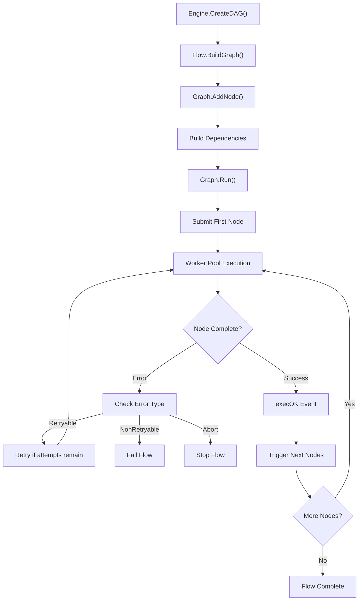

# Bizflow - Lightweight DAG Framework

A lightweight Directed Acyclic Graph (DAG) execution framework for Go, designed for orchestrating complex business workflows.

## Features

- 🚀 **Concurrent Execution** - Parallel node execution using goroutine pools
- 🔄 **Retry Mechanism** - Configurable retry policies for different error types  
- 🎯 **Dependency Management** - Automatic execution ordering based on dependencies
- 🛠️ **Simple API** - Clean interfaces for easy extension

## Quick Start

```go
// 1. Define a node
type ProcessNode struct{}

func (n *ProcessNode) Name() NodeName { return "process" }
func (n *ProcessNode) Deps() []NodeName { return []NodeName{"input"} }
func (n *ProcessNode) Meta() *Meta { return &Meta{} }
func (n *ProcessNode) Run(g *Graph) error {
    // Your business logic here
    return nil
}

// 2. Define a flow
type MyFlow struct{}

func (f *MyFlow) Name() FlowName { return "my_flow" }
func (f *MyFlow) BuildGraph(e *Engine) *Graph {
    g := e.InitGraph()
    return g.AddNode(&InputNode{}).
            AddNode(&ProcessNode{}).
            AddNode(&OutputNode{})
}

// 3. Execute
eng := NewEngine(64)
eng.AddFlow(&MyFlow{})

g := eng.CreateDAG("my_flow")
g.Run(context.TODO())
```

## Execution Flow



## Error Types

- **Retryable**: Retry based on Meta configuration
- **NonRetryable**: Immediate failure
- **Abort**: Graceful flow termination

## Dependencies

- `github.com/panjf2000/ants/v2` - High-performance goroutine pool 